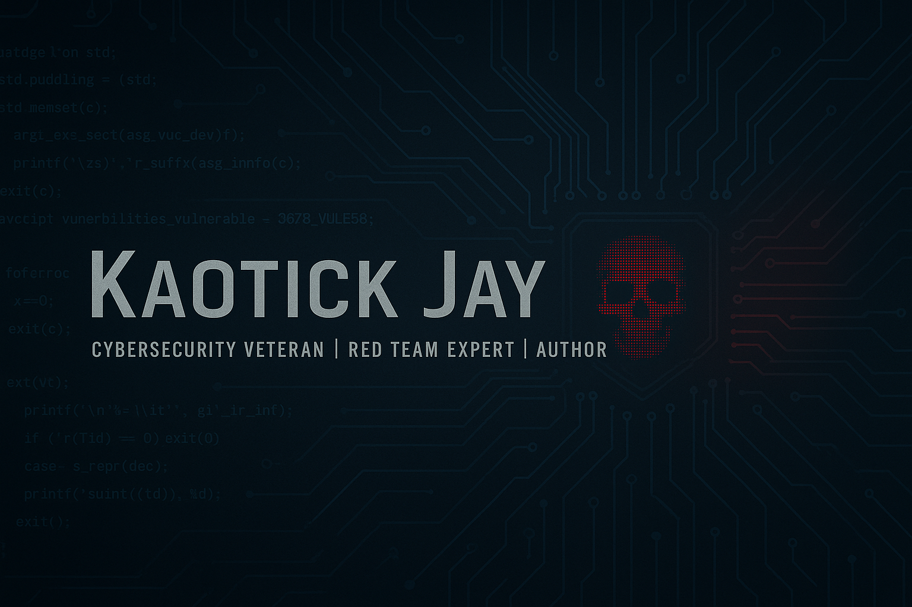
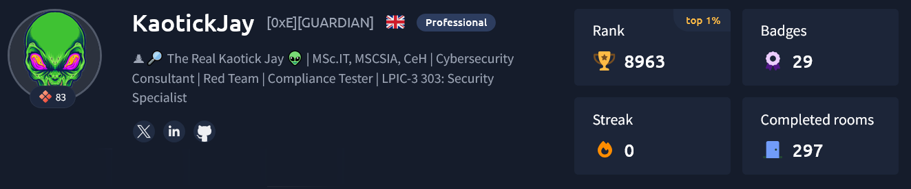

# Kaotick Jay

**Cybersecurity professional · Red team leader · Software developer · Technical author**

I'm Johnny Watts, also known as **Kaotick Jay**. Based in Southeast Tennessee, I have more than three decades of experience spanning cybersecurity, software engineering, incident response, and web technologies.

I started writing text adventures in BASIC on a TRS-80 and Commodore 64 in the early 1980s. Today, I build practical security tools, desktop software, and local-AI-powered applications, while writing about security, privacy, and operational tradecraft.

**Explore:** [Featured projects](#featured-projects) · [Cybersecurity](#cybersecurity) · [Publications](#publications) · [Community](#community-and-creative-work) · [Connect](#connect)

## Featured projects

A selection of my public repositories, including ongoing development work. Visit each repository for its current status and installation instructions.

| Project | Focus |
| --- | --- |
| [LinFo](https://github.com/kaotickj/LinFo) | Linux information gathering and security assessment tools |
| [Plague's Voice Studio](https://github.com/kaotickj/plagues-voice-studio) | Local speech synthesis and voice-production workflows |
| [Plague's Media Studio](https://github.com/kaotickj/plagues-media-studio) | Cross-platform media conversion and processing |
| [D&D Game Manager 4](https://github.com/kaotickj/d-and-d-game-manager4) | Python-based tabletop campaign and character management |
| [Plague's Blues Singer Genie](https://github.com/kaotickj/plagues-blues-singer-genie) | Creative tooling for blues artist and songwriting workflows |

More projects: [GitHub repositories](https://github.com/kaotickj?tab=repositories)

## Cybersecurity

My professional work includes:

- Penetration testing and authorized red-team operations
- Incident response, digital forensics, and malware analysis
- Risk assessments, security reviews, and defensive hardening
- Security awareness and technical training
- Assessments and consulting involving HIPAA, PCI DSS, and ISO 27001 requirements
- Cybersecurity and computer-forensics expert witness services (defense only)

I focus on defensible findings, clear reporting, and practical remediation. Security research and testing should always be conducted with appropriate authorization.

## Publications

Books, guides, and articles I've authored or shared:

- [Online Anonymity: Privacy, OPSEC, and the Art of Being Invisible](https://www.amazon.com/dp/B0FQRBYRMZ)
- [Red Team Manual: Linux Systems](https://www.amazon.com/Red-Team-Manual-Linux-Systems/dp/B0FR2BPKN5)
- [How to Dominate Local Search](https://www.amazon.com/dp/B0FRGH64GQ)
- [Protecting Yourself from Remote Access Scams (PDF)](https://kdgwebsolutions.com/Protecting-Yourself-from-Remote-Access-Scams.pdf)
- [Kaotick Jay's Guide to Securing a Linux Server (PDF)](https://kdgwebsolutions.com/Kaotick-Jays-Guide-to-Securing-a-Linux-Server.pdf)
- [How to Optimize a Website for Search Engine Indexing (PDF)](https://kdgwebsolutions.com/how-to-optimize-a-website-for-search-engine-indexing.pdf)
- [Adapting the Moscow Rules for Cybersecurity](https://www.patreon.com/posts/131833455/)

**In development:** *Cybersecurity Operations and Tradecraft: Advanced Tactics for Modern Threats* (working title).

## Community and creative work

Outside of security consulting, I work on open-source software, local AI, music production, gaming and modding projects.

- [Goodneighbor Blues](https://goodneighborblues.com/) — independent blues music and radio platform
- [YouTube](https://www.youtube.com/@kaotickj) — gaming, development, and creative projects
- [Patreon](https://www.patreon.com/c/KaotickJay) — project and creator updates

## Connect

[LinkedIn](https://www.linkedin.com/in/johnny-watts-695751125/) · [Hack The Box](https://app.hackthebox.com/profile/476578) · [TryHackMe](https://tryhackme.com/p/KaotickJay) · [Rumble](https://rumble.com/user/kaotickjay) · [Audius](https://audius.co/kaotickj) · [Spotify](https://open.spotify.com/user/31meu4olxqkys5kcwi7xu5ma5ng4) · [RSS](https://kdgwebsolutions.com/feed.xml)

## Identity and authorized use

The following statement is retained from my previous profile to help distinguish official accounts from impersonators.

🔒 Identity Clarification and Authorized Use Statement (click to expand)

## Identity Clarification and Authorized Use Statement  
**Issued by: Johnny Watts (aka. "Kaotick Jay", "kaotickj", "DJ Kaotick Jay")**  
**Date: May 16, 2025**

I, Johnny Watts, also known as Kaotick Jay in professional cybersecurity circles and DJ Kaotick Jay in music and artistic communities, am making this statement to clearly define the boundaries of my personal brand, online identity, and professional representation.

✅ Authorized Names / Handles

The following identifiers are official and used by me across various domains, including cybersecurity, digital publishing, red team engagements, musical forums, and professional networking:

    KaotickJ (preferred short username/screenname)
    
    Kaotick Jay (preferred professional alias used for authorship and public engagements)
    
    DJ Kaotick Jay (used in music and creative arts communities)

These aliases may appear on content I have authored, music I have produced, social platforms I use, or professional accounts I maintain. All uses are within my full authorization.

❌ Unauthorized and Impersonated Variants

Any name or handle beginning with the string:

    "kaotic" (with a "c") rather than "kaotick" (with a "k")

is not me, does not represent my identity, and may constitute a case of unauthorized impersonation or misuse of my brand.

Examples include (but are not limited to):

    kaoticjay
    
    kaotic_j
    
    djkaoticjay

    Any similar spelling variation attempting to resemble KaotickJ or DJ Kaotick Jay

If you encounter such names misrepresenting themselves as me, I ask that you report them immediately to the platform in question. Impersonation of a cybersecurity professional or DJ with a recognized digital and authorial footprint can have legal ramifications, especially if misleading, defamatory, or abusive behavior is involved.

📢 Public & Legal Use

This statement may be used:

    As a reference in verifying my online or professional identity
    
    To dispute false claims or impersonation
    
    In DMCA takedown notices, platform reports, and cease-and-desist demands
    
    To clarify brand ownership and authorship in content attribution disputes

For verification or inquiries regarding the authenticity of any account or publication bearing my name, I can be contacted through verified channels upon request.
Signed,

Johnny Watts, aka, "Kaotick Jay", "kaotickj", "DJ Kaotick Jay"
Cybersecurity Professional | Red Team Expert | Author | DJ Kaotick Jay

---

*This is my GitHub profile README. Project availability, maturity, and release instructions are documented in the linked repositories.*
